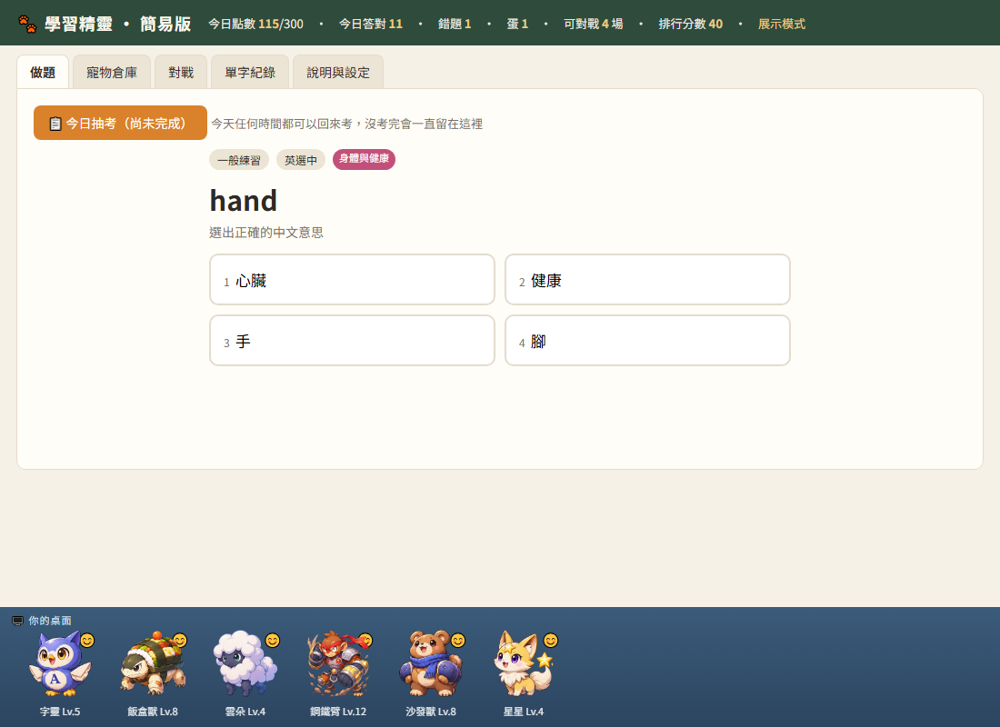

# 學習精靈（英文單字 × 寵物戰棋）

用背英文單字來養精靈寵物，再讓 6 隻寵物在六角格棋盤上自動對戰。



## 專案內容

學習精靈是一個英文單字的桌面小程式。使用者做單字題，就能孵化、餵養、進化自己的精靈寵物；寵物組成隊伍，和其他玩家的隊伍自動對戰。系統記錄每個看過的字，用 AI 模型預測哪些字快忘了，安排複習。

**要解決的問題**

- 背單字枯燥，容易半途而廢 → 用寵物養成和對戰讓人想每天回來
- 背過的字幾天後就忘，也不知道該複習哪些 → AI 預測遺忘，安排每日抽考
- 答錯的字沒有被系統化地拿回來練 → 錯題題庫與強制練錯題

**怎麼玩**

| 環節 | 內容 |
| --- | --- |
| 做題 | 英選中、中選英、例句填空、拼字四種題型，依熟練度由易到難換題型 |
| 複習 | 答錯的字進錯題題庫；每天第一次開啟有 10 題抽考；桌面寵物身上出現 ❗ 時點它做 5 題額外題目 |
| 養寵物 | 答對時桌面上每隻寵物都獲得經驗值；有 5% 機率掉蛋，答對哪一類單字就掉哪一類的蛋；學會該類單字夠多時寵物進化 |
| 對戰 | 桌面上的 6 隻寵物就是隊伍，戰前排陣後自動移動、攻擊、施放技能；學會的字越多，技能越強；組員之間有排行榜 |

**寵物**：12 種原創精靈，分屬 6 個單字類別（食物、自然、身體與健康、生活、社會與工作、通用），每種 3 個進化階段。

**設計依據**：文獻顯示遊戲化對學習有小到中等的正面效果。競技的證據最強（效果量 g = 0.386，英文單字實驗中有競賽的班學得更多）；養成寵物提升樂趣，但單靠寵物不會學得更多，所以同時有養成與對戰；社交讓人持續使用（Duolingo 有好友連續紀錄的人，完成每日課程的機率高 22%）。沒有研究直接測過這個組合，所以我們用交叉實驗自己量化。詳見 [05-考據與量化](docs/05-考據與量化.md)。

**目前進度**：產品規格已定案（[Brief](docs/01-Brief.md)、[PRD](docs/02-PRD.md)），並完成一個可以玩完整流程的簡易版原型（單一網頁）。正式版將做成 Windows 桌面程式。

| 技術 | 用途 |
| --- | --- |
| PySide6 | 桌面寵物、系統匣、視窗 |
| Flask＋SQLite | 本機出題與紀錄；對戰伺服器 |
| HTML／CSS／JavaScript／Canvas | 介面與對戰動畫 |
| Scikit-learn | 遺忘預測模型（Logistic Regression，以 Duolingo 公開資料訓練） |

## 資料夾

```
leveling_pet/
├─ README.md                 本說明
├─ docs/                     產品文件
│  ├─ 01-Brief.md            產品簡介 v3（11/18，目前的版本，以這份為準）
│  ├─ 02-PRD.md              產品需求文件 v2（11/18，依 Brief v3 改寫：功能、規則、數值、API、驗收條件）
│  ├─ 03-產品問題討論.md     會議用：待團隊決定的問題
│  ├─ 04-怎麼做這個專案.md   會議用：系統運作、分工、開發順序
│  └─ 05-考據與量化.md       文獻整理與實驗設計
├─ app/                      程式
│  └─ learning-spirit.html   簡易版原型（單一檔案，直接用瀏覽器開啟）
├─ art/                      精靈美術（12 種 × 3 階段，全部原創）
│  ├─ spirits/               精靈去背 PNG（統一檔名、256×256），原型和圖鑑使用這一份
│  └─ sprite-gallery.html    精靈圖鑑（用瀏覽器開啟）
└─ screenshots/              原型畫面截圖
```

`spirits/` 的檔名是「英文代號-階段」，例如 `cloud-3.png` 是雷雲（雲朵第 3 階）。下表依屬性列出 12 種精靈的英文代號：

| 編號 | 屬性 | 精靈（第 1 → 2 → 3 階） |
| --- | --- | --- |
| 1 | 食物 | onigiri 糰糰 → 飯盒獸 → 御膳獸；berry 莓莓 → 串串莓 → 葡萄王 |
| 2 | 自然 | sprout 芽芽 → 葉葉 → 大樹爺；cloud 雲朵 → 雨雲 → 雷雲 |
| 3 | 身體與健康 | heart 噗通 → 怦怦 → 心跳獸；fist 拳拳 → 肌肌 → 鋼鐵臂 |
| 4 | 生活 | lamp 燈燈 → 燭燭 → 燈籠仙；teddy 抱抱熊 → 沙發獸 → 小屋守衛 |
| 5 | 社會與工作 | letter 信信 → 快遞鴿 → 郵筒長；gear 齒輪 → 扳手 → 工程獸 |
| 6 | 通用 | abc 字靈 → 書靈 → 典靈；star 星星 → 亮星 → 流星 |

名字、技能和數值都是暫定，等團隊設計定案再改。

## 怎麼執行原型

用 Chrome 或 Edge 打開 `app/learning-spirit.html` 就能玩，不需要安裝任何東西。資料存在瀏覽器（localStorage），換電腦或換瀏覽器會從頭開始。

- 預設開啟「展示模式」：掉蛋率 30%、答對 3 題孵化、寵物額外題每 1 分鐘出現一次，方便現場示範
- 「說明與設定」分頁有「模擬過了一天」，可以示範每日抽考和每日對戰場數重置

## 原型和正式版的差別

| 項目 | 原型 | 正式版（依 Brief） |
| --- | --- | --- |
| 形式 | 單一網頁 | PySide6 桌面程式＋本機 Flask，網頁內嵌在 QWebEngineView |
| 對手 | 程式依玩家實力產生 | 伺服器 4 個 API：上傳隊伍、找對手、算戰鬥、排行榜 |
| 遺忘預測 | 半衰期公式暫代（`recallP()`） | Logistic Regression，以 Duolingo 資料訓練 |
| 字庫 | 60 字（6 類各 10 字），例句為示範自寫 | NGSL 300 字，例句用 Tatoeba 並標示出處 |
| 第 3 階進化 | 「學會 15 字」暫以該類全部字數為上限 | 15 字 |

可以直接沿用到正式版的程式：

- `teamSnapshot()`：要上傳到伺服器的隊伍格式
- `simulate()`：戰鬥計算，可以搬到伺服器的「算戰鬥」API
- `spriteSrc()`：精靈圖檔路徑，直接使用 `art/spirits/` 的去背 PNG

## 參考資料

- NGSL 新通用詞彙表：https://www.newgeneralservicelist.com
- Tatoeba 例句庫（CC BY 2.0 FR）：https://tatoeba.org/downloads
- Duolingo halflife-regression：https://github.com/duolingo/halflife-regression
